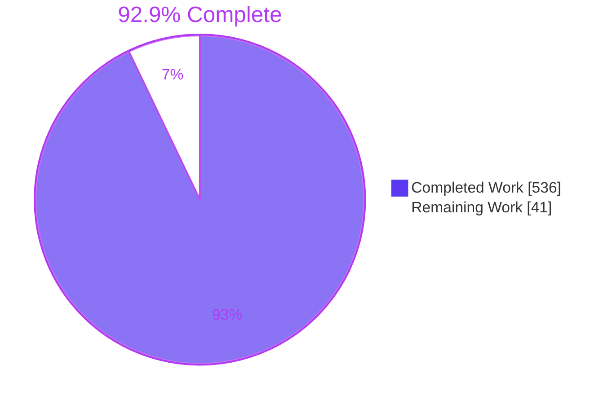
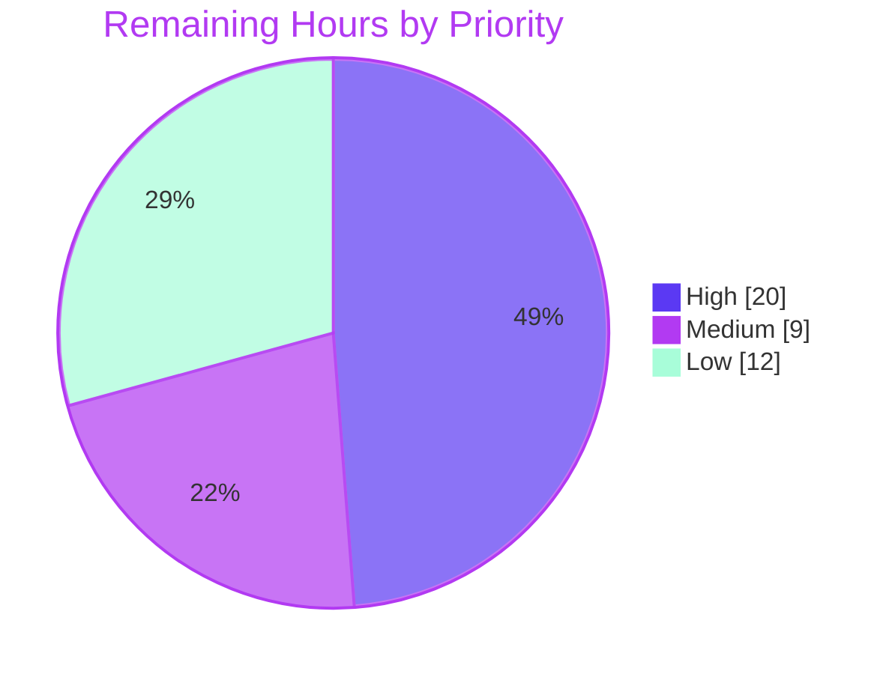

# 1. Executive Summary

## 1.1 Project Overview

This project ports the PHUSE Central Tendency programs WPCT-F.07.02 and WPCT-F.07.07 from SAS to Python under `python/wpct/`, leaving every SAS-era file unchanged. It delivers an extracted SAS specification traced to SAS lines; a Python 3.10 package reproducing the analysis datasets, PROC SUMMARY statistics and PROC GLM `SOLUTION` tables; an equivalence harness (pytest and `python -m wpct reproduce`) with a committed report; and a WPCT-F.07.02 SAS capture launcher, runbook and contract test for producing full-precision reference exports. It serves clinical statistical programmers qualifying open-source replacements for SAS.

## 1.2 Completion Status



| Metric | Hours |
|---|---|
| Total Hours | 577 |
| Completed Hours (AI + Manual) | 536 |
| Remaining Hours | 41 |
| Percent Complete | 92.9% |

536 hours are complete out of 577 total hours, so the project is 92.9% complete.

## 1.3 Key Accomplishments

- ✅ Specification Parts A–E, with 16 SAS-versus-Python default differences and every macro dispositioned (`docs/sas_specification.md`).
- ✅ All 44 SAS log record counts and all 192 listing GLM and p-value cells match.
- ✅ SAS defaults are followed: QNTLDEF=5 quantiles, the n−1 STD, sequential GLM aliasing and missing-first sorting.
- ✅ 795 of 802 suite tests and the capture contract test pass; the 7 skips are the absent optional exports.
- ✅ `python -m wpct reproduce` writes a deterministic report in about 2 s, with exit code 0, 1 or 2.
- ✅ Writes are guarded, all 36 read-only inputs match `398a6d33`, and no subject-level values are committed.
- ✅ The WPCT-F.07.02 capture launcher passes its contract test and static checks. It is UNVERIFIED IN SAS.
- ✅ `RUNBOOK.md` covers prerequisites, values to record, run and compare steps, and 17 failure points.

## 1.4 Critical Unresolved Issues

Eleven items are open; the caveats row holds three. 39 of the 40 AAP requirements are complete, and report provenance is partial. All seven work items of the refinement request (launcher, capture, export, runbook, contract test, UNVERIFIED labelling, plan) are delivered. The first three stay unverified until a licensed SAS run. Items 1 and 2 block a full-precision equivalence claim.

| Issue | Impact | Owner | ETA |
|---|---|---|---|
| Full-precision equivalence is not established. 31 quantities are NOT COMPARED (14 for WPCT-F.07.02, 17 for WPCT-F.07.07), including every PROC SUMMARY statistic, because no SAS exports exist yet. The four WPCT-F.07.07 exports have no launcher | Equivalence is proven only at listing precision | SAS programmer | 12 h |
| The WPCT-F.07.02 capture launcher has never run in SAS, so its CSVs, including `E32.17` round-trip beyond about 15 significant digits, are unverified (5.2 #12, #16) | The first licensed session may need a debug round | SAS programmer | 8 h |
| The committed report names HEAD `46178cd`, not the delivered head `ca863ee` (5.2 #3) | A squash-merge would orphan the provenance commit | Maintainer | 1 h, at merge |
| `reference/sas_exports/README.md` L64 (`BEST32.`) and L81 ("No SAS helper program is provided"), and the `README.md` layout, predate the launcher (5.2 #15) | Readers get contradictory guidance | Maintainer | 2 h |
| `RUNBOOK.md` §9 does not quote seven groups of launcher ERROR messages: the syntax-check refusal (L497), WORK/USER checks (L676–714), SASAUTOS setup (L1181–1357), capture library (L1366, L1384), staged copy (L1476, L1480), post-run checks (L1522–1557) and CSV export (L259–349) | Slower first-run debugging | Developer | 2 h |
| Three accepted launcher caveats: a Windows junction into the checkout is not detected; a run that fails part-way can leave earlier CSVs in the CSV directory, so only a session log ending `Capture finished` counts; CSVs copied into `reference/sas_exports/` for pytest are not git-ignored | A wrong file is read, or subject-level data is committed | SAS operator | Accepted (ignore rule with the README update) |
| Four message sites print paths without control-character escaping | A path containing a newline splits a one-line error | Developer | 2 h |
| The Windows and macOS write-guard and tolerance-loader branches have never run | Behaviour on those platforms is unverified | Developer | 4 h |
| A halted program leaves CSVs from an earlier run in `outputs/` | Stale files may be mistaken for current output | Developer | 2 h |

## 1.5 Access Issues

| System/Resource | Type of Access | Issue Description | Resolution Status | Owner |
|---|---|---|---|---|
| Licensed SAS 9.4 session with SAS/STAT (ideally 9.4 TS1M2 with SAS/STAT 13.2) | Software licence and execution | Needed to run the WPCT-F.07.02 capture launcher and to capture the four WPCT-F.07.07 exports. SAS is never executed in this environment, by design. SAS OnDemand for Academics excludes commercial use without permission, so a licensed partner or customer session, or an approved trial, is the safer route | Open: the user must arrange the session | SAS programmer |

## 1.6 Recommended Next Steps

1. [High] Run `python/wpct/reference/sas_capture/WPCT-F.07.02_capture.sas` once in licensed SAS 9.4, following `RUNBOOK.md` §2–§6.
2. [High] Capture the four WPCT-F.07.07 exports, run `reproduce --sas-exports` and `test_sas_exports.py`, and triage any FAIL.
3. [Medium] Obtain SAS or biostatistics sign-off of the specification, the launcher and the Section 5.2 divergences.
4. [Medium] Regenerate and commit the equivalence report on the merged commit.
5. [Low] Update the two READMEs, extend RUNBOOK §9, and close the three hardening gaps.

# 2. Project Hours Breakdown

## 2.1 Completed Work Detail

| Component | Hours | Description |
|---|---|---|
| Extracted SAS specification | 40 | `docs/sas_specification.md` (1,729 lines) holds the Sources section and Parts A–E. Its contents are the S02, S07 and LMM items with file:line citations and dispositions, the S02-DEP and S07-DEP macro closures, D-01–D-16, ENV-01–ENV-09, DIV-01 and U-01–U-03 |
| Shared foundation and write guard | 47 | `paths.py` (RepoPaths and the destination guard against protected, symlinked, hard-linked, special-file and raced targets), `schemas.py` (the single source of columns, keys and export names), `sas_semantics.py` and `errors.py` |
| XPT reader, selection and halting checks | 24 | `xpt_reader.py` (local read with SAS day numbers, ADVS member check, required-variable presence, case and type checks, truncation detection) and `selection.py` (S02/S07 filters, `$6` truncation, pooled stacking, `studynum`, the two `AnalysisHalted` checks) |
| `%derive_lastminmax_measure` port | 18 | `derivation.py`: the LMM-FLT and LMM-TRN rules, MIN/MAX/LAST and multiple modes, input-order tie rule (U-01), empty-input guard (U-03) and omission warnings with counts |
| PROC SUMMARY and PROC GLM ports | 24 | `summary.py` (QNTLDEF=5 with exact fractions, VARDEF=DF, missing-CHG exclusion) and `model.py` (explicit less-than-full-rank design, REF= last, sequential aliasing, complete-case exclusion, zero-DFE handling) |
| Program drivers and result records | 39 | `programs/wpct_f_07_02.py`, `programs/wpct_f_07_07.py` and `programs/__init__.py`: frozen `Config` defaults, SAS loop order, checkpoints, the p-value merge, per-study and pooled fits, and edge states |
| SAS reference parsers and comparison engine | 64 | `sas_reference.py` (listing, log and user-export parsers with pinned maps and validated CSV loading) and `compare.py` (all AAP 0.7.1–0.7.2 rules, statuses and reasons) |
| Export, report, provenance and CLI | 42 | `export.py` (guarded UTF-8 CSV), `report.py` (deterministic Markdown with escaping), `provenance.py` (git with list arguments, a time budget and blob integrity) and `__main__.py` (`reproduce`, exit codes 0/1/2) |
| Configuration, READMEs and committed report | 12 | `requirements.txt` (22 pins), `pyproject.toml`, `.gitignore`, `tolerances.json`, `README.md` with the licence notice, `reference/sas_exports/README.md` and `reports/equivalence_report.md` |
| Test suite | 120 | 12 modules plus `conftest.py` (14,589 lines, 802 tests): unit, end-to-end, reference-drift, guard, CLI and source-integrity cases, with mutation-checked assertions |
| Validation, security hardening and integration | 40 | Runtime verification of every CLI path, input-validation and write-route hardening, documentation-to-code synchronisation, and whole-package gating on each integration |
| WPCT-F.07.02 SAS capture launcher | 38 | `reference/sas_capture/WPCT-F.07.02_capture.sas` (1,597 lines): one USER SETTINGS block with validation; checkout-containment guards for every destination; SASAUTOS preflight of the 15 repository macro files; a staged copy with four line-and-text-checked anchors; ODS isolation; checked per-stratum appends; native `.sas7bdat` capture; `E32.17` CSV export with row-count and read-back checks; a SYSCC status line; 17 failure points |
| Capture runbook | 14 | `reference/sas_capture/RUNBOOK.md` (506 lines): capture design and the plan, prerequisites, values to record by manual commands, POSIX and Windows run steps, files produced, compare commands, the export-directory lookup, the 14 NOT COMPARED quantities and 17 failure points |
| Capture contract test | 4 | `reference/sas_capture/test_sas_capture_contract.py` (135 lines): one SAS-free test that strips SAS comments and quoted text and checks every 07.02 file and column from `wpct.schemas` against the export statements |
| Capture validation | 10 | Static checks of macro and loop balance, anchors, encodings and paths; CSV-contract checks with uncommitted stand-in export files, including malformed and `<.0001` cases; dry runs of the runbook shell commands; whole-package gating |
| **Total** | **536** | |

## 2.2 Remaining Work Detail

| Category | Hours | Priority |
|---|---|---|
| [Path-to-production] Run the WPCT-F.07.02 capture launcher once in a licensed SAS 9.4 session, debug with RUNBOOK §9, record the §3 values and check the `E32.17` CSVs against the native `.sas7bdat` copies (5.2 #12, #16) | 8 | High |
| [Path-to-production] Capture the four WPCT-F.07.07 exports to the export README contract, then run `reproduce --sas-exports` and `test_sas_exports.py` for all seven files | 6 | High |
| [Path-to-production] Triage and resolve any FAIL from the full-precision summary, GLM and record-level comparisons | 6 | High |
| [Path-to-production] SAS or biostatistics review and sign-off of the specification dispositions, DIV-01, the launcher and divergences 4–6 in Section 5.2 | 8 | Medium |
| [AAP 0.7.5] Regenerate `reports/equivalence_report.md` on the merged commit and commit it unedited (5.2 #3) | 1 | Medium |
| [Documentation] Bring `reference/sas_exports/README.md` L64/L81 and the `README.md` layout in line with the launcher, and git-ignore CSVs copied into `reference/sas_exports/` (5.2 #15) | 2 | Low |
| [Documentation] Quote the remaining launcher ERROR messages in RUNBOOK §9 failure points | 2 | Low |
| [Hardening] Route the remaining path messages through `errors.message_path`, with tests | 2 | Low |
| [Hardening] Verify the Windows and macOS write-guard and tolerance-loader branches, if those platforms are supported | 4 | Low |
| [Hardening] Clear or flag a halted program's stale CSVs from an earlier run | 2 | Low |
| **Total** | **41** | |

## 2.3 Completion Calculation

- Completed hours: 536 (Section 2.1)
- Remaining hours: 41 (Section 2.2)
- Total project hours: 536 + 41 = 577
- Completion: 536 ÷ 577 × 100 = **92.9%**

Of the 40 AAP requirements inventoried, 39 are Completed and 1 is Partially Completed (the report provenance line, at 95%). The refinement request adds 29 requirements. 28 are Completed, and 1 is Partially Completed: the launcher must produce the WPCT-F.07.02 exports exactly as the contract specifies, and that cannot be shown until it runs in SAS. The remaining hours are path-to-production, documentation and hardening work. Confidence is high for the documentation and hardening items. It is medium for the launcher run, export capture and triage, because the launcher has never executed and the full-precision outcome is unknown until the exports exist. A second debug round in SAS could add 4–8 hours.

# 3. Test Results

The full suite was run from `python/wpct/` under CPython 3.10.22 at the delivered head `ca863ee`: **795 passed, 7 skipped, 0 failed, exit 0, in 52.6 s**. The capture contract test, run by its path, gave **1 passed**. Run together, `python -m pytest tests reference/sas_capture/test_sas_capture_contract.py` gave **796 passed, 7 skipped, exit 0, in 55.6 s**. The equivalence run `python -m wpct reproduce` exited 0. Line coverage is not measured, because the project configures no coverage tooling.

| Area / Category | Framework | Tests | Passed | Failed | Coverage | What This Proves |
|---|---|---|---|---|---|---|
| XPT input and schemas (`test_xpt_reader.py`) | pytest | 72 | 72 | 0 | Not measured | ADVS is read as SAS reads it, and every missing, unreadable, truncated or mistyped input fails fast with exit 2 |
| Record selection and halting checks (`test_selection.py`) | pytest | 45 | 45 | 0 | Not measured | The S02/S07 filters, `$6` truncation, pooled identifier sort and both data-content halts follow SAS |
| LMM derivation, PROC SUMMARY and PROC GLM (`test_derivation.py`, `test_summary.py`, `test_model.py`) | pytest | 79 | 79 | 0 | Not measured | The MIN/MAX/LAST modes, definition-5 quantiles, the n−1 STD, aliasing and complete-case rules behave as SAS does |
| End-to-end drivers (`test_wpct_f_07_02.py`, `test_wpct_f_07_07.py`) | pytest | 123 | 123 | 0 | Not measured | Both programs match every log count and listing value, and every AAP 0.6.4 edge state is handled |
| SAS reference parsing and comparisons (`test_sas_reference.py`, `test_sas_exports.py`) | pytest | 243 | 236 | 0 (7 skipped) | Not measured | References are parsed at run time, and drift or malformed exports FAIL rather than passing silently |
| Report, CLI, export, guard and provenance (`test_report.py`, `test_export.py`, `test_sources_unchanged.py`) | pytest | 240 | 240 | 0 | Not measured | The report is deterministic, exit codes are 0/1/2, writes are guarded and all 36 inputs are unchanged |
| SAS capture contract (`reference/sas_capture/test_sas_capture_contract.py`) | pytest | 1 | 1 | 0 | Not measured | The launcher exports exactly the three WPCT-F.07.02 files and every column `wpct.schemas` lists for them |
| Equivalence run (`python -m wpct reproduce`) | CLI | 267 quantities | 236 PASS | 0 FAIL | 31 NOT COMPARED | Python agrees with every SAS value that exists in the repository |

The 7 skips are the `test_sas_exports.py` cases for the absent optional exports, three for WPCT-F.07.02 and four for WPCT-F.07.07. Each one reports `SAS reference export <file> not found in <dir>; see python/wpct/reference/sas_exports/README.md`.

**Not Covered**

- **The capture launcher in SAS.** No test or run executes `WPCT-F.07.02_capture.sas`. The contract test checks only its export names and columns. Before release, run it once in a licensed session (RUNBOOK §4) and confirm the 3548, 60 and 10 row counts, the per-column read-back notes and the §6 comparisons.
- **The contract test under the default command.** `python -m pytest` does not collect it (5.2 #11). Run it by path or with the combined command.
- **Full-precision SAS comparisons.** No test or run compares against real SAS exports, because none exist. That leaves out every PROC SUMMARY statistic (n, mean, std, median, min, max, Q1, Q3), full-precision GLM estimates, SE, t and p, the merged `pval`, record-level sets and per-stratum counts. The loader and comparison mechanics have run only against stand-in exports. Before release, capture the exports and run `test_sas_exports.py`.
- **Platform-specific branches.** `paths._windows_opened_path`, the macOS `F_GETPATH` branch of `_opened_path` and the `O_BINARY` open flag in `compare._read_tolerance_bytes` have never executed. Neither have the RUNBOOK's Windows commands (`start /wait`, Git Bash `sas.exe`) or the macOS `shasum` route. Test them on Windows and macOS if those platforms are supported.
- **Permission-denied export directory.** The `--sas-exports: cannot access …` branch of `__main__` needs a non-root run on a directory it cannot read.
- **Multi-member transport libraries.** Only the first member is checked. Both repository inputs hold a single member.
- **Non-default driver settings.** Settings such as a skipped GLM have no SAS output to compare with, so they are tested in-process only.

# 4. Runtime Validation & UI Verification

This project is an offline batch CLI plus a SAS launcher. It has no UI, server, ports, login or external service, so the authentication and screen checks do not apply. These flows were driven from `python/wpct/`:

- ✅ **Environment and build:** a fresh Python 3.10 virtual environment installs `requirements.txt` binary-only and `pip check` is clean. `python -W error -m compileall -q -f wpct tests reference/sas_capture` exits 0, and `ruff check` reports no violations.
- ✅ **Default reproduction:** `python -m wpct reproduce` exits 0 in about 2 s. WPCT-F.07.02 gives PASS 61, FAIL 0, NOT COMPARED 14, WPCT-F.07.07 gives 175/0/17 and the overall result is 236/0/31.
- ✅ **Intermediate exports and warnings:** 11 CSVs are written under `outputs/`, with row counts matching the SAS logs (07.02 `css_anadata` 3548, 07.07 `advs_min` 498 and `css_anadata` 996). stderr carries exactly 10 `WARNING: wpct.derivation` lines, matching the SAS log's omitted-baseline warnings, each naming only STUDYID, USUBJID, PARAMCD and ATPTN.
- ✅ **Input-error paths:** an unknown option and a missing `--sas-exports` directory each exit 2 with a one-line message and write nothing.
- ✅ **Report regeneration:** the regenerated report is deterministic and differs from the committed copy only on its provenance `HEAD` line.
- ✅ **Export comparison with launcher-shaped CSVs:** stand-in files in the launcher's format load and compare, with `E32.17` and with `BEST32.` numerics. Agreeing files bring WPCT-F.07.02 to 841 PASS, 0 FAIL, 0 NOT COMPARED. A malformed file, or `<.0001` text in `Probt`, exits 2 and writes nothing. These files hold no SAS values.
- ✅ **Capture launcher, static checks:** `%macro`/`%mend` (6/6) and `%do`/`%end` (65/65) balance, the file is ASCII with LF endings, and the four anchors match lines 85, 126, 280 and 308 of `WPCT-F.07.02.sas`. All 19 RUNBOOK `sh` blocks pass `sh -n` and `bash -n`.
- ⚠ **Capture launcher in SAS:** never exercised. Staging, ODS capture, format stripping, CSV writing and the SYSCC status are UNVERIFIED IN SAS until run in a licensed session.
- ⚠ **`--sas-exports` with real SAS exports:** never exercised at runtime. Only stand-in export folders have been loaded and compared.
- ⚠ **Windows and macOS execution:** never exercised, for both the Python package and the RUNBOOK's Windows and macOS commands. Every run used Linux.

# 5. Compliance & Quality Review

## 5.1 Compliance Matrix

| AAP Deliverable | Benchmark | Status | Evidence |
|---|---|---|---|
| Extracted specification (0.5) | Every item has an ID, a category, a SAS file:line citation, a rule and a disposition. The macro closure is complete | ✅ PASS | `docs/sas_specification.md` Parts A–E, plus 20 S02-DEP and 23 S07-DEP entries |
| Byte-for-byte preservation (0.11.2) | No SAS-era or other repository file changed | ✅ PASS | `git diff 398a6d33 HEAD -- ':!python/wpct' ':!blitzy'` is empty, and `test_sources_unchanged.py` passes 45 of 45 |
| SAS behaviour fidelity (0.6.3) | The port follows SAS wherever a library default differs (D-01–D-16) | ✅ PASS | `test_summary.py`, `test_model.py`, `test_selection.py` |
| WPCT-F.07.02 and WPCT-F.07.07 ports | 15 + 29 log checkpoints and 46 + 146 listing values agree; the pooled term is aliased | ✅ PASS | `reports/equivalence_report.md`: 61 and 175 PASS |
| Single tolerance source (0.7.1) | Both the tests and the report take their rules from `tolerances.json` | ✅ PASS (two locked keys, 5.2 #8) | `compare.load_tolerances`, and the report's tolerance table |
| No silent pass (0.7.4) | Exact comparison counts, zero FAIL, and skips that state a reason | ✅ PASS | 795 passed and 7 skipped, each skip with its reason |
| Full-precision equivalence (0.1.1, 0.7.3) | Agreement within 1e-8 and 1e-6 against SAS exports | ⚠ PENDING (licensed SAS run) | 31 NOT COMPARED rows in the report's Not compared section |
| Equivalence report (0.7.5) | Sections in order, the rounded-reference wording, determinism, committed as produced | ⚠ PARTIAL (provenance, 5.2 #3) | The wording appears 4×, and regenerations are byte-identical apart from line 8 |
| Write policy and derived data (0.8, 0.11.2) | Writes reach only `outputs/**` and the report; no subject-level values committed; three-part licence notice | ✅ PASS (concurrency caveat, 5.2 #2) | `test_export.py` and `test_report.py` guard cases; 0 subject-ID matches in the report; `README.md` Licence section |
| Environment and scope (0.4, 0.3.2) | 22 cp310 binary pins. No CI, graphics, SAS execution or network | ✅ PASS | `requirements.txt` unchanged; statsmodels only in `model.py`; `provenance.py` is the only subprocess user |
| WPCT-F.07.02 capture launcher and runbook (refinement request) | One `.sas` file with one settings block; the original runs unmodified through a checked staged copy; ODS and PROC SUMMARY capture; native plus explicit-format CSVs; UNVERIFIED label and failure points in both files; runbook covers all seven requested topics | ⚠ PASS (static); UNVERIFIED IN SAS | `WPCT-F.07.02_capture.sas` L3, L177–181, L413–423; `RUNBOOK.md` §1–§9 |
| Refinement scope and contract test | Only the launcher, runbook and one SAS-free test added under `reference/sas_capture/`; schemas, tolerances, comparison engine, CLI and existing tests unchanged | ✅ PASS | `git diff f833b97 HEAD` lists three added files only; contract test 1 passed; default suite 795/7 |

## 5.2 AAP & Rule Divergences and Gaps

No user rules were specified (AAP 0.10), so every entry below is a departure from the AAP itself. Entries #1–#8 were not requested by the user. Entries #9–#16 follow from the refinement request, which outranks the AAP, so they are marked Sanctioned.

| # | What the AAP/Rule Required | What Was Delivered Instead | Why It Diverged | Impact | Remediation |
|---|---|---|---|---|---|
| 1 | 0.1.3 / 0.6.1: specification, then 07.02, then 07.07, then tests and report | Specification first (`62099c3`). The 07.07-only `derivation` (`04ce600`) and `provenance` (`d36e0f3`) came before the 07.02 driver (`503d13e`) | Files were committed in dependency order, and the published history was not rewritten | History order only; no effect on behaviour | None required |
| 2 | 0.8: a rejected call leaves every target unopened and unchanged | Holds for every preflight rejection. An open-time refusal after a concurrent swap leaves earlier targets written (`wpct/export.py:440-446`) | All-or-nothing writes need temp files, which the policy forbids for the report | Low: needs a concurrent local attacker | None; documented |
| 3 | 0.7.5: the report records `git rev-parse HEAD` at generation, committed as produced | Line 8 names `46178cd`. The delivered head is `ca863ee`, 13 commits later | Regenerated at a commit kept in history; later commits do not change clean-run content | Provenance lags the code, and a squash-merge orphans the SHA | Regenerate after merge (Section 2.2) |
| 4 | 0.6.4: the unreadable-XPT error carries the reader message; `assert_depend` checks existence | Also rejects a non-ADVS first member, wrong variable types, case clashes and truncated files (`wpct/xpt_reader.py:239-241`) | Fail fast instead of a silent wrong read or a traceback | An input SAS accepts may exit 2. Repository data are unaffected | Reviewer confirms (Section 2.2) |
| 5 | S02/S07-TRN-01: `Config` mirrors the SAS `%let` settings | `t_var` and `tn_var` (and the 07.07 `a_fl`) must equal their defaults. The 07.02 keep list stays at 14 when `b_var` is blank (`programs/wpct_f_07_02.py:165-176`) | 0.6.4 and 0.9.5 fix the export shapes in `schemas.py` | Non-default variable choices are refused | Reviewer confirms (Section 2.2) |
| 6 | 0.6.4: a skipped GLM is marked "not produced: GLM skipped by setting" | Those listing and merged-pval rows FAIL with that reason, so the run exits 1 (`wpct/compare.py:1167-1171`) | 0.7.3 makes a listing value FAIL, never skipped | Only non-default runs are affected | Decide the exit policy (Section 2.2) |
| 7 | 0.5.3: `assert_continue` → `AnalysisHalted` | The dependency halt raises `InputDataError` (exit 2). Only the 07.07 data halts raise `AnalysisHalted` (`docs/sas_specification.md:350`) | 0.6.4 maps a missing variable to `InputDataError`, exit 2 | A missing variable exits 2 rather than 1 | None |
| 8 | 0.7.1: the user changes tolerances by editing the file alone | `counts.limit` must be 0 and `strip_trailing_blanks` must be `true`, or loading exits 2 | 0.7.1 defines both rules as fixed, and the loader always strips | 2 of 8 classes are not editable | None |
| 9 | 0.3.2 and 0.11.2: no SAS helper programs are written; export README L81 says none should be committed | A committed SAS launcher, `reference/sas_capture/WPCT-F.07.02_capture.sas` | **Sanctioned.** The refinement request asked for this launcher. SAS is still never executed | The export README now contradicts the tree (#15) | Update the README (Section 2.2) |
| 10 | 0.3.1 and 0.9.1: the exhaustive 40-file map | Three further files under `reference/sas_capture/`, making 43 tracked files | **Sanctioned.** The request limited new files to that folder and to these three | None on the port | None |
| 11 | 0.7.4 and 0.9.1: tests are pytest modules under `tests/`, collected by `testpaths=["tests"]` | `reference/sas_capture/test_sas_capture_contract.py`, outside default collection, so `python -m pytest` still collects 802 | **Sanctioned.** The request allowed new files only in `sas_capture/` and no change to `pyproject.toml` | A plain `pytest` run does not check the launcher contract | Run it by path or with the combined command (Section 9.3) |
| 12 | 0.7.3 and export README L64: numerics written with `BEST32.` | `E32.17` through `PUTN`, set by `wpct_numfmt` in the settings block (launcher L181, L315), with `BEST32.` as the fallback | **Sanctioned.** The request asked for explicit round-trip serialization and named `E32.17`; `sas_reference` parses both forms | Digits beyond about the 15th may be inexact; the 1e-8 and 1e-6 tolerances absorb that, and the `.sas7bdat` copies are exact | Confirm on the first licensed run (Section 2.2) |
| 13 | 0.3.2 and ENV-02/ENV-03: legacy environment lines are recorded, not fixed | A staged copy outside the checkout sets L85 `local=` to `data/adam/cdisc/` and L126 `outputs_folder`, and inserts capture steps after L280 and L308; the original is only read | **Sanctioned.** The request allowed a staged copy where loop capture needs edits: ParameterEstimates is overwritten at L289 and `css_stats` is deleted at L396 | The SAS run reads the local ADVS rather than the network URL; no repository file changes | None |
| 14 | 0.9.5: export names and fields are defined only in `schemas.py` | The launcher repeats the 3 file names and 36 column names literally (L413–423) | **Sanctioned.** SAS cannot import Python, and the requested contract test keeps the copies in step | A schema change needs a matching launcher edit, or the contract test fails | None |
| 15 | 0.3.1 and 0.9.1: `README.md` documents the layout, and the export README documents the export contract | Both READMEs, the specification and the report are unchanged. Export README L64 still prescribes `BEST32.`, L81 still forbids a helper program, and the layout omits `reference/sas_capture/` | **Sanctioned.** The request allowed only the three new files and no other change. RUNBOOK §1.4 explains the difference | Readers of the export README get guidance the launcher supersedes | Update both READMEs (Section 2.2) |
| 16 | Refinement request: the launcher "must produce the 07.02 reference exports exactly as specified" | Statically verified and labelled UNVERIFIED IN SAS until run in a licensed session (launcher L3, `RUNBOOK.md` L3) | **Sanctioned (caveat).** The same request states that SAS cannot run here and that the launcher must not be claimed to work | No WPCT-F.07.02 NOT COMPARED quantity closes until the licensed run | Run it once (Section 2.2) |

**3. Report provenance.** `reports/equivalence_report.md` is an unedited `reproduce` output. Its line 8 records `46178cd`, the commit it was generated at. The delivered head `ca863ee` is 13 commits later. Of those commits, one regenerates the report, two change absent-value rendering and tolerance-file refusal, one adds `blitzy/documentation/`, and nine add `reference/sas_capture/`, which `reproduce` never reads. None of them alters a clean run, so regenerating today changes line 8 and nothing else. The SHA resolves (`git merge-base --is-ancestor 46178cd HEAD` exits 0), but a squash-merge would remove it from the target branch. After merging, run `python -m wpct reproduce` on the merged commit and commit the report as produced.

**4. Stricter XPT input contract.** AAP 0.6.4 defines the unreadable-file error as one raised when pyreadstat fails or returns no columns, carrying the reader's message. `assert_depend` checks only that variables exist. The reader also refuses four further cases: a first transport member not named ADVS (`wpct/xpt_reader.py:71,239-241`), whereas SAS selects ADVS by name among members; required variables of the wrong SAS type; two spellings of one variable; and truncated or damaged files. Each produces `InputDataError` and exit 2 with the port's own reason. Both repository files are single-member ADVS, so the results are unaffected. A reviewer should confirm that the additions are acceptable.

**5. Driver settings narrower than SAS.** The `Config` dataclasses hold the SAS `%let` defaults, as AAP S02-TRN-01 and S07-TRN-01 require. SAS would accept any variable for `t_var` or `tn_var`, but the port refuses names other than the defaults, and also any 07.07 `a_fl` other than ANL02FL (`programs/wpct_f_07_02.py:165-176`). The export schemas in `schemas.py`, which AAP 0.6.4 and 0.9.5 make binding, fix those columns as keys, BY variables and CLASS effects. The 07.02 keep list also stays at 14 variables when `b_var` is blank, where SAS would keep 13. Default runs are unaffected. A reviewer should confirm that other variable choices are out of scope.

**6. Reporting a deliberately skipped GLM.** AAP 0.6.4 says that when `b_var` or `ref_trtn` is unset, the model quantities are marked "not produced: GLM skipped by setting". The comparison engine marks each listing ParameterEstimates row and merged-pval cell FAIL with exactly this reason, and adds a NOT COMPARED entry (`wpct/compare.py:1167-1171`), so such a run exits 1. This follows AAP 0.7.3, under which a listing value is never skipped. The CLI always uses the default settings, so only in-process runs reach this path. The owner should decide whether a deliberate skip should exit 0 instead.

**8. Two tolerance settings are fixed.** AAP 0.7.1 says the user changes tolerances by editing `tolerances.json` alone. The loader accepts edits to every numeric limit, but it rejects `counts.limit` other than 0 and `categorical.strip_trailing_blanks` other than `true`, with exit 2. AAP 0.7.1 defines counts as exact integer equality and the categorical rule as equality after stripping trailing blanks. Both the export loader and pyreadstat always strip trailing blanks, so a `false` value would appear in the tolerance table without being applied. Leave this as is unless the reviewer wants those two rules made configurable, which would need loader changes.

**12. Numeric CSV format.** AAP 0.7.3 and the export README L64 specify `BEST32.` for every numeric. The refinement request asked instead for explicit serialization that round-trips floating-point values, naming `E32.17` and asking that it be confirmed against the project's reader. The launcher removes every format (L304) and writes each numeric with `PUTN` and the `wpct_numfmt` setting (L181, L315), and `sas_reference` parses both forms. SAS documents that formatted output beyond about the 15th significant digit may be inexact, so exact round-trip is unproven. The launcher logs a per-column read-back check against the native values. On the first licensed run, read those notes, and use the `BEST32.` fallback only if they warrant it.

**15. Documents that predate the launcher.** AAP 0.3.1 and 0.9.1 make `python/wpct/README.md` the description of the package layout and `reference/sas_exports/README.md` the export contract. Both still describe the tree before the launcher. The export README L64 prescribes `BEST32.`, L81 says no SAS helper program is provided and none should be committed, and the layout omits `reference/sas_capture/`. The refinement request allowed only the three new files, so none of these was edited, and RUNBOOK §1.4 explains the difference. In a follow-up change, update both READMEs and add a `.gitignore` rule for CSVs copied into `reference/sas_exports/`.

**16. Launcher unverified in SAS.** The refinement request requires the launcher to produce the WPCT-F.07.02 exports exactly as `reference/sas_exports/README.md` and `wpct/schemas.py` specify. The same paragraph states that SAS cannot run here and that the launcher must not be claimed to work. The launcher is therefore verified statically: macro balance, anchors against the original, export names and columns (the contract test), and the CSV format against the Python loader. Its header (L3) and `RUNBOOK.md` (L3) carry the label UNVERIFIED IN SAS until run in a licensed session, and both list 17 failure points. No WPCT-F.07.02 NOT COMPARED quantity closes until a person runs it once (RUNBOOK §4) and compares the exports (§6).

# 6. Risk Assessment

| Risk | Category | Severity | Probability | Mitigation | Status |
|---|---|---|---|---|---|
| Full-precision equivalence is unproven. All PROC SUMMARY statistics and the full-precision GLM values (31 quantities) have never been compared with SAS | Technical | High | Medium | Run the WPCT-F.07.02 launcher, capture the four WPCT-F.07.07 exports and run `reproduce --sas-exports`. The tolerances are already fixed in `tolerances.json` | Open |
| The 1,597-line capture launcher has never run in SAS, so its first licensed session will likely need a debug round (ODS table names, macro scoping, format stripping, SASAUTOS quoting, encoding). Its `E32.17` CSVs may differ beyond about 15 significant digits | Technical | High | High | RUNBOOK §9 lists 17 failure points with symptoms and debug steps. An anchor mismatch stops before anything runs, and the native `.sas7bdat` copies are exact. Hand the first run to a SAS programmer | Open |
| Subject-level data could leak: CSVs copied into `reference/sas_exports/` are not git-ignored, and derivation warnings print USUBJID to stderr, which CI logs or shell captures could retain | Security (data protection) | Medium | Low | RUNBOOK §6.3 removes the copies and checks `git status`. Add an ignore rule, and treat stderr as subject-level output | Open |
| Four message sites (`xpt_reader`, `compare.load_tolerances`, `OutputPathError`, `__main__._display_path`) print paths without escaping control characters. Writes are not atomic under a concurrent destination swap, and a child process of a timed-out git command can outlive it | Security / Operational | Low | Low | Route the messages through `errors.message_path`. The write and git behaviour is documented, and only one git call can time out per run (30 s budget) | Open (messages), Accepted (writes, git) |
| The report's provenance commit `46178cd` disappears if the branch is squash-merged | Integration | Medium | High (if squash-merged) | Regenerate the report on the merged commit and commit it unedited | Open |
| Windows and macOS paths have never run: the Python write guard and tolerance loader, the RUNBOOK's `start /wait` and Git Bash routes, and `shasum`. On Windows the launcher does not detect a junction into the checkout | Technical | Medium | Medium (if those platforms are used) | Run the suite on each supported platform. Keep the capture directories on plain paths outside the checkout | Open |
| Stale files may be mistaken for current output: a halted Python program leaves earlier CSVs in `outputs/<program>/`, and a capture run that fails part-way can leave CSVs it wrote earlier | Operational | Low | Medium | Clear or flag stale `outputs/` files. For the launcher, use the CSVs only when the session log's last line starts `Capture finished`, never `Capture failed` | Open |
| The pinned log and listing line maps date from the 2016 SAS reference revision, and the reader assumes single-member XPT files | Integration | Low | Low | References are immutable and guarded by `test_sources_unchanged.py`, and any drift FAILs loudly | Accepted |

# 7. Visual Project Status


Remaining work by priority (41 hours, from Section 2.2):



| Remaining category (Section 2.2) | Hours | Priority |
|---|---|---|
| WPCT-F.07.02 launcher licensed run and debug | 8 | High |
| WPCT-F.07.07 export capture and full-precision run | 6 | High |
| Full-precision FAIL triage | 6 | High |
| SAS/biostatistics review and sign-off | 8 | Medium |
| Report regeneration at merge | 1 | Medium |
| README updates and export ignore rule | 2 | Low |
| RUNBOOK failure-point messages | 2 | Low |
| Message escaping | 2 | Low |
| Windows/macOS verification | 4 | Low |
| Stale outputs after a halt | 2 | Low |
| **Total** | **41** | |

# 8. Summary & Recommendations

The WPCT Python port is **92.9% complete**: 536 of 577 hours. All AAP artefacts and the WPCT-F.07.02 capture tooling exist as 43 files under `python/wpct/`, and no SAS-era or other repository file has changed. The extracted specification traces every SAS rule and macro to its source lines and records how the port treats it. The package reproduces both programs' analysis datasets, PROC SUMMARY statistics and PROC GLM `SOLUTION` tables. The harness has 802 suite tests and a single `reproduce` command, which verifies the Python results against every SAS value in the repository.

The verified state is strong at the precision the repository allows. All 44 SAS log record counts match exactly. All 192 listing-based GLM and merged p-value cells match at displayed precision, including the aliased pooled `studynum` term. 795 tests pass, the only 7 skips are the optional export cases with their stated reasons, and the overall result is 236 PASS, 0 FAIL. The guard keeps every write inside the two permitted destinations, the 36 read-only inputs remain byte-identical to `398a6d33`, and the committed report carries no subject-level values. The capture launcher for WPCT-F.07.02 passes its contract test and every static check, and its runbook gives the run, record and compare steps. It is UNVERIFIED IN SAS until run in a licensed session.

The critical gap is full-precision equivalence. The summary statistics exist in SAS only as raster images and no full-precision exports exist yet, so 31 quantities remain NOT COMPARED. The critical path runs through a licensed SAS 9.4 session: run the launcher and debug it with RUNBOOK §9 (8 h), capture the four WPCT-F.07.07 exports (6 h), run `reproduce --sas-exports` and `test_sas_exports.py`, and triage any FAIL (6 h). A SAS or biostatistics reviewer should then sign off the specification, the launcher and the divergences in Section 5.2 (8 h), and the report should be regenerated on the merged commit (1 h).

Success means four things. The launcher's final log line reports `Capture finished with SYSCC=0` with the 3548, 60 and 10 row counts. `python -m wpct reproduce --sas-exports DIR` reports 0 FAIL with the seven export groups present. `test_sas_exports.py` runs all seven cases without skips. The regenerated report's provenance names a commit on the target branch. The documentation and hardening items (12 h) can follow without blocking adoption.

**Production readiness:** ready for review and for the licensed capture run. The port should not be cited as equivalent to SAS at full precision until the export comparisons pass.

# 9. Development Guide

## 9.1 System Prerequisites

- Linux. Every verified run used Linux. The code has Windows and macOS branches, but they have never run (Section 3).
- CPython **3.10** (verified with 3.10.22). Every pin in `requirements.txt` ships a cp310 binary wheel.
- git with the full, non-shallow history. Commit `398a6d33` must be present for the source-integrity checks. Without it, those tests skip with a stated reason.
- No network access at run time. No database, service, port or credential is needed.
- For the SAS capture only: a licensed SAS 9.4 session with Base SAS and SAS/STAT, ideally 9.4 TS1M2 with SAS/STAT 13.2. On Windows, use a checkout made with `core.autocrlf=false` so the recorded hashes match (`reference/sas_capture/RUNBOOK.md` §2–§3).

## 9.2 Environment Setup

Run every command from the project folder `python/wpct/`. Keep the virtual environment outside the checkout, because `.gitignore` does not ignore one.

```bash
cd python/wpct
python3.10 -m venv ~/.venvs/wpct
~/.venvs/wpct/bin/pip install --only-binary :all: -r requirements.txt
~/.venvs/wpct/bin/pip check          # expected: No broken requirements found.
```

Optionally, set single-threaded BLAS so that results are deterministic on shared hosts:

```bash
export OPENBLAS_NUM_THREADS=1 OMP_NUM_THREADS=1
```

## 9.3 Build and Verify

```bash
cd python/wpct
~/.venvs/wpct/bin/python -W error -m compileall -q -f wpct tests reference/sas_capture   # expected: exit 0, no output
~/.venvs/wpct/bin/python -m pytest                                                     # expected: 795 passed, 7 skipped in about 55 s
```

Each of the 7 skips reports `SAS reference export <file> not found in <dir>; see python/wpct/reference/sas_exports/README.md`.

The capture contract test sits outside the default `testpaths`, so run it by path, alone or with the suite:

```bash
~/.venvs/wpct/bin/python -m pytest reference/sas_capture/test_sas_capture_contract.py               # expected: 1 passed
~/.venvs/wpct/bin/python -m pytest tests reference/sas_capture/test_sas_capture_contract.py         # expected: 796 passed, 7 skipped
```

On a host shared with other users, give pytest a private temporary directory outside the checkout. pytest wipes that directory on every run, and its parent must already exist:

```bash
mkdir -p ~/.cache && ~/.venvs/wpct/bin/python -m pytest --basetemp="$HOME/.cache/wpct-pytest"
```

To run a single module:

```bash
~/.venvs/wpct/bin/python -m pytest tests/test_summary.py   # expected: 34 passed
```

## 9.4 Run the Reproduction

```bash
cd python/wpct
~/.venvs/wpct/bin/python -m wpct reproduce
```

Expected stdout (about 2 s):

```text
WPCT-F.07.02: PASS 61, FAIL 0, NOT COMPARED 14; outputs in python/wpct/outputs/WPCT-F.07.02
WPCT-F.07.07: PASS 175, FAIL 0, NOT COMPARED 17; outputs in python/wpct/outputs/WPCT-F.07.07
Overall: PASS 236, FAIL 0, NOT COMPARED 31
Report: python/wpct/reports/equivalence_report.md
```

stderr carries exactly 10 `WARNING: wpct.derivation: ...` lines. These are the same omissions that SAS logs. The command writes `outputs/WPCT-F.07.0{2,7}/*.csv` (git-ignored) and regenerates `reports/equivalence_report.md`.

To compare against full-precision SAS exports, place the CSVs described in `reference/sas_exports/README.md` in a directory and run:

```bash
~/.venvs/wpct/bin/python -m wpct reproduce --sas-exports /path/to/exports
~/.venvs/wpct/bin/python -m pytest tests/test_sas_exports.py
```

Exit codes: `0` means no comparison failed and no program halted, `1` means a comparison failed or a program halted, and `2` means an input error, a rejected destination or a bad option.

**Capturing the WPCT-F.07.02 exports.** `reference/sas_capture/RUNBOOK.md` is the authoritative procedure. The launcher is UNVERIFIED IN SAS until run in a licensed session. In outline, with absolute paths outside the checkout, first set the directories and copy the launcher into the work directory:

```bash
WPCT_REPO=/absolute/path/to/phuse-scripts
WPCT_WORKDIR=/absolute/path/to/wpct-capture
WPCT_CSVDIR="$WPCT_WORKDIR/csv"
mkdir -p "$WPCT_WORKDIR"
cp "$WPCT_REPO/python/wpct/reference/sas_capture/WPCT-F.07.02_capture.sas" "$WPCT_WORKDIR/"
```

Edit only the USER SETTINGS block of the copy (`wpct_repo`, `wpct_workdir`, `wpct_csvdir`, `wpct_encoding`, `wpct_numfmt`), using the same absolute paths. Then run it once in a fresh licensed session:

```bash
cd "$WPCT_WORKDIR"
sas -sysin WPCT-F.07.02_capture.sas -log WPCT-F.07.02_session.log -print WPCT-F.07.02_session.lst
echo $?   # 0 complete, 1 complete with a launcher WARNING, 2 refused or failed
```

Then compare from `python/wpct/` (RUNBOOK §6.2–§6.3), and leave nothing in the checkout:

```bash
cd "$WPCT_REPO/python/wpct"
~/.venvs/wpct/bin/python -m wpct reproduce --sas-exports "$WPCT_CSVDIR"
git checkout -- reports/equivalence_report.md
cp "$WPCT_CSVDIR"/WPCT-F.07.02_*.csv reference/sas_exports/
~/.venvs/wpct/bin/python -m pytest tests/test_sas_exports.py
rm reference/sas_exports/WPCT-F.07.02_*.csv
git status --porcelain   # expected: no output
```

Record the values in RUNBOOK §3 (commit, input hashes, SAS release, OS, encoding, options) with the exports. Commit none of the capture outputs: `css_anadata` is subject-level.

## 9.5 Committed Report Convention

After a run, check what changed in the report:

```bash
git diff reports/equivalence_report.md
```

If only line 8 (the checkout `HEAD`) differs, restore the committed copy with `git checkout -- reports/equivalence_report.md`. Commit a regenerated report only when its content beyond line 8 changes, or on the final merged commit. Never edit it by hand.

## 9.6 Troubleshooting

| Symptom | Cause | Resolution |
|---|---|---|
| `error: externally-managed-environment` during install | The system Python is in use | Install into the 3.10 virtual environment shown above |
| pip tries to build pyreadstat from source | A Python other than 3.10 is in use, or `--only-binary` was omitted | Use CPython 3.10 and `--only-binary :all:` |
| `no tests ran` | pytest was started from the repository root | `cd python/wpct` first |
| The contract test does not appear in a `python -m pytest` run | It sits outside `testpaths = ["tests"]` by design | Run it by path (Section 9.3) |
| Ruff reports I001 on every test file | Ruff was run from the repository root | Run `ruff check --no-fix --no-cache --target-version py310 wpct tests` from `python/wpct/` |
| `--sas-exports: not an existing directory: …`, exit 2 | The named exports folder does not exist | Create it, or omit the option to use `reference/sas_exports/` |
| `cannot load the tolerances: invalid tolerance file …`, exit 2 | `tolerances.json` is malformed, not a regular file, sets `counts.limit` other than 0, or sets `strip_trailing_blanks` other than `true` | Restore the committed file and edit only the numeric limits |
| `... cannot read SAS transport file ...: member ADVS not found`, exit 2 | The XPT's first member is not ADVS | Supply an ADVS-only transport file |
| The 36 source-integrity tests are skipped | Shallow clone, or commit `398a6d33` absent | `git fetch --unshallow` |
| Exit 1 with `FAIL` rows | A reference drifted or an export disagrees | Read the FAIL reasons in `reports/equivalence_report.md`. Reasons name the keys, never record values |
| Every export-dependent test errors at setup after copying CSVs into `reference/sas_exports/` | A copied CSV does not load (for example `<.0001` text or a missing column) | Fix the export, or remove the copies; see RUNBOOK §6.3 |
| The launcher log shows `ERROR: (WPCT CAPTURE) ...` or `Capture failed with SYSCC=...` | A settings, containment, anchor, macro or capture check refused the run | Look up the message in RUNBOOK §9 failure points 1–17, fix the cause, and rerun in a fresh session |

# 10. Appendices

## A. Command Reference

| Purpose | Command (from `python/wpct/`) |
|---|---|
| Create the environment | `python3.10 -m venv ~/.venvs/wpct && ~/.venvs/wpct/bin/pip install --only-binary :all: -r requirements.txt` |
| Check the dependencies | `~/.venvs/wpct/bin/pip check` |
| Compile with warnings as errors | `~/.venvs/wpct/bin/python -W error -m compileall -q -f wpct tests reference/sas_capture` |
| Run the full test suite | `~/.venvs/wpct/bin/python -m pytest` |
| Run one test module | `~/.venvs/wpct/bin/python -m pytest tests/test_model.py` |
| Run the capture contract test | `~/.venvs/wpct/bin/python -m pytest reference/sas_capture/test_sas_capture_contract.py` |
| Run the suite and the contract test together | `~/.venvs/wpct/bin/python -m pytest tests reference/sas_capture/test_sas_capture_contract.py` |
| Reproduce both programs | `~/.venvs/wpct/bin/python -m wpct reproduce` |
| Reproduce with SAS exports | `~/.venvs/wpct/bin/python -m wpct reproduce --sas-exports DIR` |
| Show CLI help | `~/.venvs/wpct/bin/python -m wpct reproduce --help` |
| Run the SAS capture (in the capture work directory, licensed SAS) | `sas -sysin WPCT-F.07.02_capture.sas -log WPCT-F.07.02_session.log -print WPCT-F.07.02_session.lst` |
| Lint (optional; not a gate) | `ruff check --no-fix --no-cache --target-version py310 wpct tests reference/sas_capture/test_sas_capture_contract.py` |
| Restore the committed report | `git checkout -- reports/equivalence_report.md` |

## B. Port Reference

| Port | Service | Notes |
|---|---|---|
| — | None | `python -m wpct reproduce` is an offline batch CLI. It opens no ports and starts no server, and it needs no database, queue, network or credentials. |

## C. Key File Locations

| Path | Role |
|---|---|
| `python/wpct/docs/sas_specification.md` | Deliverable 1, the extracted SAS specification |
| `python/wpct/wpct/` | Deliverable 2, the package: `xpt_reader`, `selection`, `derivation`, `summary`, `model`, `export`, `sas_reference`, `compare`, `report`, `provenance`, `paths`, `schemas`, `sas_semantics`, `errors`, `__main__` |
| `python/wpct/wpct/programs/` | The drivers `wpct_f_07_02.py` and `wpct_f_07_07.py`, plus `ProgramResult` and its records |
| `python/wpct/tests/` | 12 test modules and `conftest.py` |
| `python/wpct/reports/equivalence_report.md` | Deliverable 3, the generated report, committed as produced |
| `python/wpct/tolerances.json` | The single tolerance source |
| `python/wpct/reference/sas_exports/README.md` | The contract for user-supplied full-precision SAS exports |
| `python/wpct/reference/sas_capture/WPCT-F.07.02_capture.sas` | The WPCT-F.07.02 SAS capture launcher (UNVERIFIED IN SAS until run in a licensed session) |
| `python/wpct/reference/sas_capture/RUNBOOK.md` | Capture prerequisites, values to record, run and compare steps, and failure points |
| `python/wpct/reference/sas_capture/test_sas_capture_contract.py` | The SAS-free contract test between the launcher and `wpct/schemas.py` |
| `python/wpct/outputs/` | Generated intermediate CSVs (git-ignored) |
| `whitepapers/WPCT/WPCT-F.07.02.sas`, `whitepapers/utilities/` | The read-only original program and macros the launcher runs |
| `whitepapers/WPCT/outputs_sas/WPCT-F.07.0{2,7}.{lst,log}` | The read-only SAS reference listings and logs |
| `data/adam/cdisc/advs.xpt`, `data/adam/cdisc-split/advs.xpt` | The read-only inputs for 07.02 and 07.07 |

## D. Technology Versions

| Component | Version |
|---|---|
| CPython | 3.10.22 |
| numpy | 2.2.6 |
| pandas | 2.3.3 |
| scipy | 1.15.3 |
| statsmodels | 0.15.0 |
| pyreadstat | 1.3.6 |
| pytest | 9.2.0 |
| Transitive pins | python-dateutil 3.0.0, pytz 2026.6, tzdata 2026.6, patsy 1.0.3, formulaic 1.2.2, narwhals 2.28.0, interface-meta 2.0.1, wrapt 2.5.2, packaging 26.3, six 1.17.0, typing-extensions 4.16.0, iniconfig 2.3.1, pluggy 1.7.0, pygments 2.21.0, exceptiongroup 1.3.1, tomli 2.5.0 |
| SAS reference provenance | SAS 9.4 TS1M2 with SAS/STAT 13.2, listings and logs from commit `6fc757d` |
| SAS for the capture launcher | SAS 9.4 with Base SAS and SAS/STAT. The original program halts below 9.4M2; 9.4 TS1M2 with SAS/STAT 13.2 matches the references |

## E. Environment Variable Reference

| Variable | Required | Purpose |
|---|---|---|
| `OPENBLAS_NUM_THREADS=1` | No | Single-threaded BLAS for deterministic runs on shared hosts |
| `OMP_NUM_THREADS=1` | No | As above, for OpenMP |
| `WPCT_REPO`, `WPCT_WORKDIR`, `WPCT_CSVDIR` | For the capture runbook only | Shell variables the RUNBOOK commands use for the checkout, the capture work directory and its CSV folder. They must equal the launcher's settings |

The Python application reads no other environment variable, credential or secret. The launcher takes its settings only from its USER SETTINGS block: `wpct_repo`, `wpct_workdir`, `wpct_csvdir` (default `&wpct_workdir/csv`), `wpct_encoding` (`latin1`, or `wlatin1` on Windows) and `wpct_numfmt` (`E32.17`, or `BEST32.` as the fallback).

## F. Developer Tools Guide

- **Traceability:** test names and docstrings cite specification IDs (for example `test_s02_mod_02_...` and `test_s02_trn_03_mod_01_mod_02_capture_launcher_exports_07_02_contract`). Every cited ID must exist in `docs/sas_specification.md`.
- **Single sources:** export file names, keys and field lists live only in `wpct/schemas.py`, and both READMEs quote them verbatim. The capture launcher repeats the WPCT-F.07.02 names literally, because SAS cannot import Python, and the contract test fails if they drift. Comparison rules live only in `wpct/compare.py` and `tolerances.json`.
- **Write policy:** writes go only through `export.write_program_outputs` and `report.write_report`, and both pass `paths.check_write_destination`. Tests opt in to a temporary write root through the `write_paths` fixture. The launcher directs every output to its work and CSV directories, and refuses either directory when it lies inside the checkout or is a parent of it.
- **Read reach:** XPT files are read only through `xpt_reader`, SAS references only through `sas_reference`, and git only through `provenance`.

## G. Glossary

| Term | Meaning |
|---|---|
| ADVS | The ADaM vital-signs analysis dataset, read from SAS transport (XPT v5) files |
| PROC SUMMARY | The SAS descriptive-statistics procedure, ported in `summary.proc_summary` |
| PROC GLM `SOLUTION` | The SAS general linear model parameter-estimates table, ported in `model.glm_solution` |
| QNTLDEF=5 | The SAS default quantile definition (Hyndman–Fan type 2) |
| Aliased (`B`) | A GLM column linearly dependent on earlier columns. Its estimate is set to 0, and its SE, t and p are left missing |
| `studynum` / `&stdyn` | The study number assigned after sorting, and the count of studies including the pooled study |
| NOT COMPARED | A quantity with no SAS reference value. It is never counted as PASS |
| LMM | `%derive_lastminmax_measure`, the 07.07 MIN/MAX/LAST derivation macro |
| Staged copy | `WPCT-F.07.02_staged.sas`, written by the launcher in the capture work directory: the original program with four checked anchor edits. Never committed |
| ODS OUTPUT | The SAS mechanism that saves a procedure table, here ParameterEstimates, as a dataset |
| `E32.17` | The SAS scientific-notation format, 32 wide with 17 decimals, that the launcher uses for numeric CSV values |
| SYSCC | The SAS session condition code: 0 clean, 4 warning, 8 or more error. The launcher's exit status follows it |
| UNVERIFIED IN SAS | The label on the launcher and RUNBOOK: written without a SAS engine and never run, so not claimed to work |
