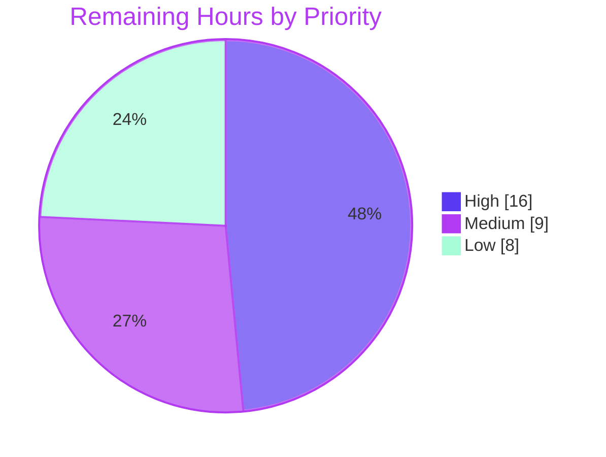

# 1. Executive Summary

## 1.1 Project Overview

This project ports the PHUSE Central Tendency programs WPCT-F.07.02 and WPCT-F.07.07 from SAS to Python without changing any SAS-era file. It delivers three artefacts under `python/wpct/`:

- an extracted SAS specification that traces every rule, filter, derivation, model and macro dependency to its SAS lines;
- a Python 3.10 package that reproduces the intermediate datasets, the PROC SUMMARY statistics and the PROC GLM `SOLUTION` tables;
- an equivalence harness, a pytest suite plus `python -m wpct reproduce`, that checks the results against the SAS listings and logs under fixed tolerances and writes a committed report.

It is built for clinical statistical programmers who are qualifying open-source replacements for SAS analyses.

## 1.2 Completion Status


| Metric | Hours |
|---|---|
| Total Hours | 503 |
| Completed Hours (AI + Manual) | 470 |
| Remaining Hours | 33 |
| Percent Complete | 93.4% |

470 hours are complete out of 503 total hours, so the project is 93.4% complete.

## 1.3 Key Accomplishments

- ✅ The specification covers Parts A–E, including 16 SAS-versus-Python default differences, and gives every macro a disposition (`docs/sas_specification.md`).
- ✅ All 15 + 29 SAS log record-count checkpoints match exactly.
- ✅ All 46 + 146 ParameterEstimates and merged p-value cells match the SAS listings, including the aliased pooled `studynum`.
- ✅ The port follows SAS where library defaults differ: QNTLDEF=5 quantiles, the n−1 STD divisor, sequential GLM aliasing and missing-first stable sorting.
- ✅ 795 of 802 tests pass. The 7 skips are optional SAS-export cases, and each states its reason.
- ✅ One command, `python -m wpct reproduce` (about 2 s), produces a deterministic report and returns exit code 0, 1 or 2.
- ✅ A write guard confines every write to `outputs/**` and the report. All 36 read-only inputs match upstream commit `398a6d33`.
- ✅ The committed report holds no subject-level values.

## 1.4 Critical Unresolved Issues

Five items are open. One of the 40 AAP requirements is partially complete (report provenance). Only item 1 blocks a full-precision equivalence claim.

| Issue | Impact | Owner | ETA |
|---|---|---|---|
| Full-precision equivalence is not established. 31 quantities are NOT COMPARED, including every PROC SUMMARY statistic, because no SAS exports exist | Equivalence is proven only at listing precision | SAS programmer | 16 h |
| The committed report names HEAD `46178cd`, not the delivered head (5.2 #3) | A squash-merge would orphan the provenance commit | Maintainer | 1 h, at merge |
| Four message sites print paths without control-character escaping | A path containing a newline splits a one-line error | Developer | 2 h |
| The Windows and macOS write-guard and tolerance-loader branches have never run | Behaviour on those platforms is unverified | Developer | 4 h |
| A halted program leaves CSVs from an earlier run in `outputs/` | Stale files may be mistaken for current output | Developer | 2 h |

## 1.5 Access Issues

| System/Resource | Type of Access | Issue Description | Resolution Status | Owner |
|---|---|---|---|---|
| Licensed SAS 9.4 session | Software licence and execution | Needed to capture the seven full-precision exports. The run never executes SAS, by design | Open: the user must supply the exports | SAS programmer |

## 1.6 Recommended Next Steps

1. [High] Capture the seven exports described in `python/wpct/reference/sas_exports/README.md`, then run `python -m wpct reproduce --sas-exports DIR` and the test suite.
2. [High] Triage any FAIL from those full-precision comparisons.
3. [Medium] Have a SAS or biostatistics reviewer sign off the specification and the divergences in Section 5.2.
4. [Medium] After merging, regenerate the equivalence report and commit it unedited.
5. [Low] Close the three hardening gaps: message escaping, cross-platform checks and stale outputs.

# 2. Project Hours Breakdown

## 2.1 Completed Work Detail

| Component | Hours | Description |
|---|---|---|
| Extracted SAS specification | 40 | `docs/sas_specification.md` (1,729 lines) holds the Sources section and Parts A–E. Its contents are the S02, S07 and LMM items with file:line citations and dispositions, the S02-DEP and S07-DEP macro closures, D-01–D-16, ENV-01–ENV-09, DIV-01 and U-01–U-03 |
| Shared foundation and write guard | 47 | `paths.py` (RepoPaths and the destination guard against protected, symlinked, hard-linked, special-file and raced targets), `schemas.py` (the single source of columns, keys and export names), `sas_semantics.py` and `errors.py` |
| XPT reader, selection and halting checks | 24 | `xpt_reader.py` (local read with SAS day numbers, ADVS member check, required-variable presence, case and type checks, truncation detection) and `selection.py` (S02/S07 filters, `$6` truncation, pooled stacking, `studynum`, the two `AnalysisHalted` checks) |
| `%derive_lastminmax_measure` port | 18 | `derivation.py`: the LMM-FLT and LMM-TRN rules, MIN/MAX/LAST and multiple modes, input-order tie rule (U-01), empty-input guard (U-03) and omission warnings with counts |
| PROC SUMMARY and PROC GLM ports | 24 | `summary.py` (QNTLDEF=5 with exact fractions, VARDEF=DF, missing-CHG exclusion) and `model.py` (explicit less-than-full-rank design, REF= last, sequential aliasing, complete-case exclusion, zero-DFE handling) |
| Program drivers and result records | 39 | `programs/wpct_f_07_02.py`, `programs/wpct_f_07_07.py` and `programs/__init__.py`: frozen `Config` defaults, SAS loop order, checkpoints, the p-value merge, per-study and pooled fits, and edge states |
| SAS reference parsers and comparison engine | 64 | `sas_reference.py` (listing, log and user-export parsers with pinned maps and validated CSV loading) and `compare.py` (all AAP 0.7.1–0.7.2 rules, statuses and reasons) |
| Export, report, provenance and CLI | 42 | `export.py` (guarded UTF-8 CSV), `report.py` (deterministic Markdown with escaping), `provenance.py` (git with list arguments, a time budget and blob integrity) and `__main__.py` (`reproduce`, exit codes 0/1/2) |
| Configuration, READMEs and committed report | 12 | `requirements.txt` (22 pins), `pyproject.toml`, `.gitignore`, `tolerances.json`, `README.md` with the licence notice, `reference/sas_exports/README.md` and `reports/equivalence_report.md` |
| Test suite | 120 | 12 modules plus `conftest.py` (14,589 lines, 802 tests): unit, end-to-end, reference-drift, guard, CLI and source-integrity cases, with mutation-checked assertions |
| Validation, security hardening and integration | 40 | Runtime verification of every CLI path, input-validation and write-route hardening, documentation-to-code synchronisation, and whole-package gating on each integration |
| **Total** | **470** | |

## 2.2 Remaining Work Detail

| Category | Hours | Priority |
|---|---|---|
| [Path-to-production] Capture the 7 full-precision SAS exports in a licensed SAS 9.4 session and run `reproduce --sas-exports` and `test_sas_exports.py` | 10 | High |
| [Path-to-production] Triage and resolve any FAIL from the full-precision summary, GLM and record-level comparisons | 6 | High |
| [Path-to-production] SAS or biostatistics review and sign-off of the specification dispositions, DIV-01 and divergences 4–8 in Section 5.2 | 8 | Medium |
| [AAP 0.7.5] Regenerate `reports/equivalence_report.md` on the merged commit and commit it unedited | 1 | Medium |
| [Hardening] Route the remaining path messages through `errors.message_path`, with tests | 2 | Low |
| [Hardening] Verify the Windows and macOS write-guard and tolerance-loader branches, if those platforms are supported | 4 | Low |
| [Hardening] Clear or flag a halted program's stale CSVs from an earlier run | 2 | Low |
| **Total** | **33** | |

## 2.3 Completion Calculation

- Completed hours: 470 (Section 2.1)
- Remaining hours: 33 (Section 2.2)
- Total project hours: 470 + 33 = 503
- Completion: 470 ÷ 503 × 100 = **93.4%**

Of the 40 AAP requirements inventoried, 39 are Completed and 1 is Partially Completed (the report provenance line, at 95%). The remaining hours are path-to-production and hardening work. The confidence is high for the hardening items. It is medium for the export capture and triage, because the full-precision outcome is unknown until the SAS exports exist.

# 3. Test Results

The full suite was run from `python/wpct/` under CPython 3.10.22 at the delivered head: **795 passed, 7 skipped, 0 failed, exit 0, in 48.9 s**. The equivalence run `python -m wpct reproduce` exited 0. Line coverage is not measured, because the project configures no coverage tooling.

| Area / Category | Framework | Tests | Passed | Failed | Coverage | What This Proves |
|---|---|---|---|---|---|---|
| XPT input and schemas (`test_xpt_reader.py`) | pytest | 72 | 72 | 0 | Not measured | ADVS is read as SAS reads it, and every missing, unreadable, truncated or mistyped input fails fast with exit 2 |
| Record selection and halting checks (`test_selection.py`) | pytest | 45 | 45 | 0 | Not measured | The S02/S07 filters, `$6` truncation, pooled identifier sort and both data-content halts follow SAS |
| LMM derivation (`test_derivation.py`) | pytest | 26 | 26 | 0 | Not measured | The MIN/MAX/LAST modes, ties, both-phase rule, AVISITN codes and empty input behave as the macro does |
| PROC SUMMARY and PROC GLM (`test_summary.py`, `test_model.py`) | pytest | 53 | 53 | 0 | Not measured | Definition-5 quantiles, the n−1 STD, MODEL-order columns, aliasing and complete-case rules match SAS |
| End-to-end drivers (`test_wpct_f_07_02.py`, `test_wpct_f_07_07.py`) | pytest | 123 | 123 | 0 | Not measured | Both programs match every log count and listing value, and every AAP 0.6.4 edge state is handled |
| SAS reference parsing and comparisons (`test_sas_reference.py`, `test_sas_exports.py`) | pytest | 243 | 236 | 0 (7 skipped) | Not measured | References are parsed at run time, and drift or malformed exports FAIL rather than passing silently |
| Report, CLI, export, guard and provenance (`test_report.py`, `test_export.py`, `test_sources_unchanged.py`) | pytest | 240 | 240 | 0 | Not measured | The report is deterministic, exit codes are 0/1/2, writes are guarded and all 36 inputs are unchanged |
| Equivalence run (`python -m wpct reproduce`) | CLI | 267 quantities | 236 PASS | 0 FAIL | 31 NOT COMPARED | Python agrees with every SAS value that exists in the repository |

The 7 skips are the `test_sas_exports.py` cases for the absent optional exports. Each one reports `SAS reference export <file> not found in <dir>; see python/wpct/reference/sas_exports/README.md`.

**Not Covered**

- **Full-precision SAS comparisons.** No test or run compares against real SAS exports, because none exist. That leaves out every PROC SUMMARY statistic (n, mean, std, median, min, max, Q1, Q3), full-precision GLM estimates, SE, t and p, the merged `pval`, record-level sets and per-stratum counts. The loader and the comparison mechanics have run only against synthetic exports. Before release, capture the exports and run `test_sas_exports.py`.
- **Platform-specific branches.** `paths._windows_opened_path`, the macOS `F_GETPATH` branch of `_opened_path` and the `O_BINARY` open flag in `compare._read_tolerance_bytes` have never executed. Test them on Windows and macOS if those platforms are supported.
- **Permission-denied export directory.** The `--sas-exports: cannot access …` branch of `__main__` needs a non-root run on a directory it cannot read.
- **Multi-member transport libraries.** Only the first member is checked. Both repository inputs hold a single member.
- **Non-default driver settings.** Settings such as a skipped GLM have no SAS output to compare with, so they are tested in-process only.

# 4. Runtime Validation & UI Verification

This project is an offline batch CLI. It has no UI, server, ports, login or external service, so the authentication and screen checks do not apply. These flows were driven from `python/wpct/`:

- ✅ **Environment:** a fresh Python 3.10 virtual environment installs `requirements.txt` binary-only, and `pip check` reports no broken requirements.
- ✅ **Build:** `python -W error -m compileall -q -f wpct tests` exits 0, and `ruff check` reports no violations.
- ✅ **Default reproduction:** `python -m wpct reproduce` exits 0 in about 2 s. WPCT-F.07.02 gives PASS 61, FAIL 0, NOT COMPARED 14, WPCT-F.07.07 gives 175/0/17 and the overall result is 236/0/31.
- ✅ **Intermediate exports:** 11 CSVs are written under `outputs/`. Their row counts match the SAS logs: 07.02 `css_anadata` 3548, 07.07 `advs_min` 498 and `css_anadata` 996.
- ✅ **Derivation warnings:** stderr carries exactly 10 `WARNING: wpct.derivation` lines, matching the 10 omitted-baseline warnings in the SAS log. Each names only STUDYID, USUBJID, PARAMCD and ATPTN.
- ✅ **Input-error paths:** an unknown option and a missing `--sas-exports` directory each exit 2 with a one-line message and write nothing.
- ✅ **Report regeneration:** the regenerated report is deterministic and differs from the committed copy only on its provenance `HEAD` line.
- ⚠ **`--sas-exports` with real SAS exports:** never exercised at runtime. Only synthetic export folders have been loaded and compared.
- ⚠ **Windows and macOS execution:** never exercised. Every run used Linux.

# 5. Compliance & Quality Review

## 5.1 Compliance Matrix

| AAP Deliverable | Benchmark | Status | Evidence |
|---|---|---|---|
| Extracted specification (0.5) | Every item has an ID, a category, a SAS file:line citation, a rule and a disposition. The macro closure is complete | ✅ PASS | `docs/sas_specification.md` Parts A–E, plus 20 S02-DEP and 23 S07-DEP entries |
| Byte-for-byte preservation (0.11.2) | No file outside `python/wpct/` changed | ✅ PASS | `git diff 398a6d33 -- ':!python/wpct'` is empty, and `test_sources_unchanged.py` passes 45 of 45 |
| SAS behaviour fidelity (0.6.3) | The port follows SAS wherever a library default differs (D-01–D-16) | ✅ PASS | `test_summary.py`, `test_model.py`, `test_selection.py` |
| WPCT-F.07.02 port | 15 log checkpoints and 46 listing values agree | ✅ PASS | `reports/equivalence_report.md` section WPCT-F.07.02: 61 PASS |
| WPCT-F.07.07 port | 29 log checkpoints and 146 listing values agree; the pooled term is aliased | ✅ PASS | Report section WPCT-F.07.07: 175 PASS |
| Single tolerance source (0.7.1) | Both the tests and the report take their rules from `tolerances.json` | ✅ PASS (two locked keys, 5.2 #8) | `compare.load_tolerances`, and the report's tolerance table |
| No silent pass (0.7.4) | Exact comparison counts, zero FAIL, and skips that state a reason | ✅ PASS | 795 passed and 7 skipped, each skip with its reason |
| Full-precision equivalence (0.1.1, 0.7.3) | Agreement within 1e-8 and 1e-6 against SAS exports | ⚠ PENDING (user exports) | 31 NOT COMPARED rows in the report's Not compared section |
| Equivalence report (0.7.5) | Sections in order, the rounded-reference wording, determinism, committed as produced | ⚠ PARTIAL (provenance, 5.2 #3) | The wording appears 4×, and two regenerations are byte-identical apart from line 8 |
| Write policy (0.8) | Writes reach only `outputs/**` and the report | ✅ PASS (concurrency caveat, 5.2 #2) | `test_export.py`, `test_report.py` guard cases |
| Derived data and licence (0.11.2) | No subject-level values committed, and the three-part licence notice is present | ✅ PASS | The report has 0 subject-ID matches; `README.md` Licence section |
| Environment and scope (0.4, 0.3.2) | 22 cp310 binary pins. No CI, graphics, SAS execution or network | ✅ PASS | `requirements.txt`; statsmodels is imported only in `model.py`; `provenance.py` is the only subprocess user |

## 5.2 AAP & Rule Divergences and Gaps

No user rules were specified (AAP 0.10), so every entry below is a departure from the AAP itself. None was requested by the user, so none is marked Sanctioned.

| # | What the AAP/Rule Required | What Was Delivered Instead | Why It Diverged | Impact | Remediation |
|---|---|---|---|---|---|
| 1 | 0.1.3 / 0.6.1: specification, then 07.02, then 07.07, then tests and report | Specification first (`62099c3`). The 07.07-only `derivation` (`04ce600`) and `provenance` (`d36e0f3`) came before the 07.02 driver (`503d13e`) | Files were committed in dependency order, and the published history was not rewritten | History order only; no effect on behaviour | None required |
| 2 | 0.8: a rejected call leaves every target unopened and unchanged | Holds for every preflight rejection. An open-time refusal after a concurrent swap leaves earlier targets written (`wpct/export.py:440-446`) | All-or-nothing writes need temp files, which the policy forbids for the report | Low: needs a concurrent local attacker | None; documented |
| 3 | 0.7.5: the report records `git rev-parse HEAD` at generation, committed as produced | Line 8 names `46178cd`. The delivered head is `8ac400c`, two code commits later | Regenerated at a commit kept in history; later commits do not change clean-run content | Provenance lags the code, and a squash-merge orphans the SHA | Regenerate after merge (Section 2.2) |
| 4 | 0.6.4: the unreadable-XPT error carries the reader message; `assert_depend` checks existence | Also rejects a non-ADVS first member, wrong variable types, case clashes and truncated files (`wpct/xpt_reader.py:239-241`) | Fail fast instead of a silent wrong read or a traceback | An input SAS accepts may exit 2. Repository data are unaffected | Reviewer confirms (Section 2.2) |
| 5 | S02/S07-TRN-01: `Config` mirrors the SAS `%let` settings | `t_var` and `tn_var` (and the 07.07 `a_fl`) must equal their defaults. The 07.02 keep list stays at 14 when `b_var` is blank (`programs/wpct_f_07_02.py:165-176`) | 0.6.4 and 0.9.5 fix the export shapes in `schemas.py` | Non-default variable choices are refused | Reviewer confirms (Section 2.2) |
| 6 | 0.6.4: a skipped GLM is marked "not produced: GLM skipped by setting" | Those listing and merged-pval rows FAIL with that reason, so the run exits 1 (`wpct/compare.py:1167-1171`) | 0.7.3 makes a listing value FAIL, never skipped | Only non-default runs are affected | Decide the exit policy (Section 2.2) |
| 7 | 0.5.3: `assert_continue` → `AnalysisHalted` | The dependency halt raises `InputDataError` (exit 2). Only the 07.07 data halts raise `AnalysisHalted` (`docs/sas_specification.md:350`) | 0.6.4 maps a missing variable to `InputDataError`, exit 2 | A missing variable exits 2 rather than 1 | None |
| 8 | 0.7.1: the user changes tolerances by editing the file alone | `counts.limit` must be 0 and `strip_trailing_blanks` must be `true`, or loading exits 2 | 0.7.1 defines both rules as fixed, and the loader always strips | 2 of 8 classes are not editable | None |

**1. Delivery order.** The AAP fixes the order as specification, then the 07.02 implementation, then 07.07, then the tests and report, with each part consuming the one before it. The specification commit `62099c3` precedes all code, and every module imports only modules committed before it. However, `wpct.derivation` (`04ce600`), which only WPCT-F.07.07 uses, and `wpct.provenance` (`d36e0f3`) were committed before the WPCT-F.07.02 driver (`503d13e`). Files were produced in dependency order rather than strict program order, and the published history was not rewritten afterwards. No delivered behaviour depends on commit order. Action is needed only if a program-ordered history is required, which would mean a rebase.

**2. Write-guard atomicity.** AAP 0.8 says one refused target leaves every target of the writer call unopened. `paths.vet_fixed_destination` checks every target before anything opens, so every rejection the guard can make holds the guarantee. The second check happens at open time, and catches a destination replaced by a symlink, hard link or special file after the preflight. That refusal cannot undo files already written by the same call (`wpct/export.py:440-446`). Undoing them would need temporary files and renames, which the write policy forbids for the report. The scenario needs a concurrent local process racing the run. The behaviour is documented in `paths.py`, `export.py`, `report.py`, `errors.py` and `README.md`, so no action is required.

**3. Report provenance.** `reports/equivalence_report.md` is an unedited `reproduce` output. Its line 8 records `46178cd`, the commit it was generated at. The branch head `8ac400c` is two commits later. Those commits changed absent-value rendering, tolerance-file refusal and diagnostic wording, none of which alters a clean run, so regenerating today changes line 8 and nothing else. The SHA resolves (`git merge-base --is-ancestor 46178cd HEAD` exits 0), but a squash-merge would remove it from the target branch. After merging, run `python -m wpct reproduce` on the merged commit and commit the report as produced.

**4. Stricter XPT input contract.** AAP 0.6.4 defines the unreadable-file error as one raised when pyreadstat fails or returns no columns, carrying the reader's message. `assert_depend` checks only that variables exist. The reader also refuses four further cases: a first transport member not named ADVS (`wpct/xpt_reader.py:71,239-241`), whereas SAS selects ADVS by name among members; required variables of the wrong SAS type; two spellings of one variable; and truncated or damaged files. Each produces `InputDataError` and exit 2 with the port's own reason. These additions stop silent wrong reads and late tracebacks, and the S02/S07-DEP port notes record each one. Both repository files are single-member ADVS, so the results are unaffected. A reviewer should confirm that the additions are acceptable.

**5. Driver settings narrower than SAS.** The `Config` dataclasses hold the SAS `%let` defaults, as AAP S02-TRN-01 and S07-TRN-01 require. SAS would accept any variable for `t_var` or `tn_var`, but the port refuses names other than the defaults, and also any 07.07 `a_fl` other than ANL02FL (`programs/wpct_f_07_02.py:165-176`). The export schemas in `schemas.py`, which AAP 0.6.4 and 0.9.5 make binding, fix those columns as keys, BY variables and CLASS effects. Similarly, the 07.02 keep list stays at 14 variables when `b_var` is blank, where SAS would keep 13. The specification's port notes record both points. Default runs are unaffected. A reviewer should confirm that other variable choices are out of scope.

**6. Reporting a deliberately skipped GLM.** AAP 0.6.4 says that when `b_var` or `ref_trtn` is unset, the model quantities are marked "not produced: GLM skipped by setting". The comparison engine marks each listing ParameterEstimates row and merged-pval cell of that program FAIL with exactly this reason, and also adds a NOT COMPARED entry to the Not compared section (`wpct/compare.py:1167-1171`). As a result, such a run exits 1. This follows AAP 0.7.3, which says a listing value is never skipped, because a model that was not fitted cannot match the SAS listing. The CLI always uses the default settings, so only in-process runs reach this path. The owner should decide whether a deliberate skip should exit 0 instead.

**7. Dependency-halt disposition.** AAP 0.5.3 lists `assert_continue` as ported to `errors.AnalysisHalted`. AAP 0.6.4 maps "A required variable missing" to `InputDataError`, and 0.6.5 gives input errors exit code 2. The two rows meet at the `assert_depend`/`assert_continue` calls (WPCT-F.07.02.sas:158, WPCT-F.07.07.sas:204), so the more specific 0.6.4 rule was applied there: a missing variable raises `InputDataError` from `xpt_reader.require_variables` and exits 2. The data-content halts in 07.07 (S07-FLT-04, S07-FLT-05) still raise `AnalysisHalted` and exit 1. The specification records this split (`docs/sas_specification.md:350`). No action is needed.

**8. Two tolerance settings are fixed.** AAP 0.7.1 says the user changes tolerances by editing `tolerances.json` alone. The loader accepts edits to every numeric limit, but it rejects `counts.limit` other than 0 and `categorical.strip_trailing_blanks` other than `true`, with exit 2. AAP 0.7.1 defines counts as exact integer equality and the categorical rule as equality after stripping trailing blanks. In addition, both the export loader and pyreadstat always strip trailing blanks, so a `false` value would appear in the report's tolerance table without being applied. Leave this as is unless the reviewer wants those two rules made configurable, which would require loader changes.

# 6. Risk Assessment

| Risk | Category | Severity | Probability | Mitigation | Status |
|---|---|---|---|---|---|
| Full-precision equivalence is unproven. All PROC SUMMARY statistics and the full-precision GLM values (31 quantities) have never been compared with SAS | Technical | High | Medium | Capture the 7 exports and run `reproduce --sas-exports`. The tolerances are already fixed in `tolerances.json` | Open |
| The report's provenance commit `46178cd` disappears if the branch is squash-merged | Integration | Medium | High (if squash-merged) | Regenerate the report on the merged commit and commit it unedited | Open |
| Derivation warnings print subject identifiers (USUBJID) to stderr, which CI logs or shell captures could retain | Security (data protection) | Low | Medium | Treat stderr as subject-level output. The committed report and the tracked files hold no subject values | Accepted |
| Four message sites (`xpt_reader`, `compare.load_tolerances`, `OutputPathError`, `__main__._display_path`) print paths without escaping control characters | Security | Low | Low | Route them through `errors.message_path`, as the export loader already does | Open |
| Writes are not atomic under a concurrent destination swap, and a child process of a timed-out git command can outlive it | Security / Operational | Low | Low | Documented behaviour. Only one git call can time out per run (30 s budget) | Accepted |
| The Windows and macOS code paths of the write guard and the tolerance loader have never run | Technical | Medium | Medium (if those platforms are used) | Run the suite on each supported platform before claiming support | Open |
| A halted program leaves CSVs from an earlier run in `outputs/<program>/` | Operational | Low | Medium | Clear the program's output directory through `export.py`, or flag stale files in the report | Open |
| The pinned log and listing line maps date from the 2016 SAS reference revision, and the reader assumes single-member XPT files | Integration | Low | Low | References are immutable and guarded by `test_sources_unchanged.py`, and any drift FAILs loudly | Accepted |

# 7. Visual Project Status


Remaining work by priority (33 hours, from Section 2.2):



| Remaining category (Section 2.2) | Hours | Priority |
|---|---|---|
| SAS export capture and full-precision run | 10 | High |
| Full-precision FAIL triage | 6 | High |
| SAS/biostatistics review and sign-off | 8 | Medium |
| Report regeneration at merge | 1 | Medium |
| Message escaping | 2 | Low |
| Windows/macOS verification | 4 | Low |
| Stale outputs after a halt | 2 | Low |
| **Total** | **33** | |

# 8. Summary & Recommendations

The WPCT Python port is **93.4% complete**: 470 of 503 hours. All three AAP artefacts exist as 40 new files under `python/wpct/`, and nothing outside that folder has changed. The extracted specification traces every SAS rule and macro to its source lines and records how the port treats it. The package reproduces both programs' analysis datasets, PROC SUMMARY statistics and PROC GLM `SOLUTION` tables. The harness has 802 tests and a single `reproduce` command, which verifies the Python results against every SAS value in the repository.

The verified state is strong at the precision the repository allows. All 44 SAS log record counts match exactly. All 192 listing-based GLM and merged p-value cells match at displayed precision, including the aliased pooled `studynum` term. 795 tests pass, the only 7 skips are the optional export cases with their stated reasons, and the overall result is 236 PASS, 0 FAIL. The guard keeps every write inside the two permitted destinations, the 36 read-only inputs remain byte-identical to `398a6d33`, and the committed report carries no subject-level values.

The critical gap is full-precision equivalence. The summary statistics exist in SAS only as raster images, and no full-precision exports exist, so 31 quantities remain NOT COMPARED, as the AAP anticipates. The critical path to production therefore runs through a licensed SAS 9.4 session: capture the seven exports to the documented contract (10 h), run `reproduce --sas-exports` and `test_sas_exports.py`, and triage any FAIL (6 h). A SAS or biostatistics reviewer should then sign off the specification and the eight divergences in Section 5.2 (8 h). The report should be regenerated on the merged commit (1 h).

Success means three things: `python -m wpct reproduce --sas-exports DIR` reports 0 FAIL with the seven export groups present, `test_sas_exports.py` runs all seven cases without skips, and the regenerated report's provenance names a commit on the target branch. The three low-priority hardening items (8 h) can follow without blocking adoption.

**Production readiness:** ready for review and for full-precision validation. The port should not be cited as equivalent to SAS at full precision until the export comparisons pass.

# 9. Development Guide

## 9.1 System Prerequisites

- Linux. Every verified run used Linux. The code has Windows and macOS branches, but they have never run (Section 3).
- CPython **3.10** (verified with 3.10.22). Every pin in `requirements.txt` ships a cp310 binary wheel.
- git with the full, non-shallow history. Commit `398a6d33` must be present for the source-integrity checks. Without it, those tests skip with a stated reason.
- No network access at run time. No database, service, port or credential is needed.

## 9.2 Environment Setup

Run every command from the project folder `python/wpct/`. Keep the virtual environment outside the checkout, because `.gitignore` does not ignore one.

```bash
cd python/wpct
python3.10 -m venv ~/.venvs/wpct
~/.venvs/wpct/bin/pip install --only-binary :all: -r requirements.txt
~/.venvs/wpct/bin/pip check          # expected: No broken requirements found.
```

Optionally, set single-threaded BLAS so that results are deterministic on shared hosts:

```bash
export OPENBLAS_NUM_THREADS=1 OMP_NUM_THREADS=1
```

## 9.3 Build and Verify

```bash
cd python/wpct
~/.venvs/wpct/bin/python -W error -m compileall -q -f wpct tests   # expected: exit 0, no output
~/.venvs/wpct/bin/python -m pytest                                  # expected: 795 passed, 7 skipped in about 50 s
```

Each of the 7 skips reports `SAS reference export <file> not found in <dir>; see python/wpct/reference/sas_exports/README.md`.

On a host shared with other users, give pytest a private temporary directory outside the checkout. pytest wipes that directory on every run, and its parent must already exist:

```bash
mkdir -p ~/.cache && ~/.venvs/wpct/bin/python -m pytest --basetemp="$HOME/.cache/wpct-pytest"
```

To run a single module:

```bash
~/.venvs/wpct/bin/python -m pytest tests/test_summary.py   # expected: 34 passed
```

## 9.4 Run the Reproduction

```bash
cd python/wpct
~/.venvs/wpct/bin/python -m wpct reproduce
```

Expected stdout (about 2 s):

```text
WPCT-F.07.02: PASS 61, FAIL 0, NOT COMPARED 14; outputs in python/wpct/outputs/WPCT-F.07.02
WPCT-F.07.07: PASS 175, FAIL 0, NOT COMPARED 17; outputs in python/wpct/outputs/WPCT-F.07.07
Overall: PASS 236, FAIL 0, NOT COMPARED 31
Report: python/wpct/reports/equivalence_report.md
```

stderr carries exactly 10 `WARNING: wpct.derivation: ...` lines. These are the same omissions that SAS logs. The command writes `outputs/WPCT-F.07.0{2,7}/*.csv` (git-ignored) and regenerates `reports/equivalence_report.md`.

To compare against full-precision SAS exports, place the seven CSVs described in `reference/sas_exports/README.md` in a directory and run:

```bash
~/.venvs/wpct/bin/python -m wpct reproduce --sas-exports /path/to/exports
~/.venvs/wpct/bin/python -m pytest tests/test_sas_exports.py
```

Exit codes: `0` means no comparison failed and no program halted, `1` means a comparison failed or a program halted, and `2` means an input error, a rejected destination or a bad option.

## 9.5 Committed Report Convention

After a run, check what changed in the report:

```bash
git diff reports/equivalence_report.md
```

If only line 8 (the checkout `HEAD`) differs, restore the committed copy with `git checkout -- reports/equivalence_report.md`. Commit a regenerated report only when its content beyond line 8 changes, or on the final merged commit. Never edit it by hand.

## 9.6 Troubleshooting

| Symptom | Cause | Resolution |
|---|---|---|
| `error: externally-managed-environment` during install | The system Python is in use | Install into the 3.10 virtual environment shown above |
| pip tries to build pyreadstat from source | A Python other than 3.10 is in use, or `--only-binary` was omitted | Use CPython 3.10 and `--only-binary :all:` |
| `no tests ran` | pytest was started from the repository root | `cd python/wpct` first |
| Ruff reports I001 on every test file | Ruff was run from the repository root | Run `ruff check --no-fix --no-cache --target-version py310 wpct tests` from `python/wpct/` |
| `--sas-exports: not an existing directory: …`, exit 2 | The named exports folder does not exist | Create it, or omit the option to use `reference/sas_exports/` |
| `cannot load the tolerances: invalid tolerance file …`, exit 2 | `tolerances.json` is malformed, not a regular file, sets `counts.limit` other than 0, or sets `strip_trailing_blanks` other than `true` | Restore the committed file and edit only the numeric limits |
| `... cannot read SAS transport file ...: member ADVS not found`, exit 2 | The XPT's first member is not ADVS | Supply an ADVS-only transport file |
| The 36 source-integrity tests are skipped | Shallow clone, or commit `398a6d33` absent | `git fetch --unshallow` |
| Exit 1 with `FAIL` rows | A reference drifted or an export disagrees | Read the FAIL reasons in `reports/equivalence_report.md`. Reasons name the keys, never record values |

# 10. Appendices

## A. Command Reference

| Purpose | Command (from `python/wpct/`) |
|---|---|
| Create the environment | `python3.10 -m venv ~/.venvs/wpct && ~/.venvs/wpct/bin/pip install --only-binary :all: -r requirements.txt` |
| Check the dependencies | `~/.venvs/wpct/bin/pip check` |
| Compile with warnings as errors | `~/.venvs/wpct/bin/python -W error -m compileall -q -f wpct tests` |
| Run the full test suite | `~/.venvs/wpct/bin/python -m pytest` |
| Run one test module | `~/.venvs/wpct/bin/python -m pytest tests/test_model.py` |
| Reproduce both programs | `~/.venvs/wpct/bin/python -m wpct reproduce` |
| Reproduce with SAS exports | `~/.venvs/wpct/bin/python -m wpct reproduce --sas-exports DIR` |
| Show CLI help | `~/.venvs/wpct/bin/python -m wpct reproduce --help` |
| Lint (optional; not a gate) | `ruff check --no-fix --no-cache --target-version py310 wpct tests` |
| Restore the committed report | `git checkout -- reports/equivalence_report.md` |

## B. Port Reference

| Port | Service | Notes |
|---|---|---|
| — | None | `python -m wpct reproduce` is an offline batch CLI. It opens no ports and starts no server, and it needs no database, queue, network or credentials. |

## C. Key File Locations

| Path | Role |
|---|---|
| `python/wpct/docs/sas_specification.md` | Deliverable 1, the extracted SAS specification |
| `python/wpct/wpct/` | Deliverable 2, the package: `xpt_reader`, `selection`, `derivation`, `summary`, `model`, `export`, `sas_reference`, `compare`, `report`, `provenance`, `paths`, `schemas`, `sas_semantics`, `errors`, `__main__` |
| `python/wpct/wpct/programs/` | The drivers `wpct_f_07_02.py` and `wpct_f_07_07.py`, plus `ProgramResult` and its records |
| `python/wpct/tests/` | 12 test modules and `conftest.py` |
| `python/wpct/reports/equivalence_report.md` | Deliverable 3, the generated report, committed as produced |
| `python/wpct/tolerances.json` | The single tolerance source |
| `python/wpct/reference/sas_exports/README.md` | The contract for user-supplied full-precision SAS exports |
| `python/wpct/outputs/` | Generated intermediate CSVs (git-ignored) |
| `whitepapers/WPCT/outputs_sas/WPCT-F.07.0{2,7}.{lst,log}` | The read-only SAS reference listings and logs |
| `data/adam/cdisc/advs.xpt`, `data/adam/cdisc-split/advs.xpt` | The read-only inputs for 07.02 and 07.07 |

## D. Technology Versions

| Component | Version |
|---|---|
| CPython | 3.10.22 |
| numpy | 2.2.6 |
| pandas | 2.3.3 |
| scipy | 1.15.3 |
| statsmodels | 0.15.0 |
| pyreadstat | 1.3.6 |
| pytest | 9.2.0 |
| Transitive pins | python-dateutil 3.0.0, pytz 2026.6, tzdata 2026.6, patsy 1.0.3, formulaic 1.2.2, narwhals 2.28.0, interface-meta 2.0.1, wrapt 2.5.2, packaging 26.3, six 1.17.0, typing-extensions 4.16.0, iniconfig 2.3.1, pluggy 1.7.0, pygments 2.21.0, exceptiongroup 1.3.1, tomli 2.5.0 |
| SAS reference provenance | SAS 9.4 TS1M2 with SAS/STAT 13.2, listings and logs from commit `6fc757d` |

## E. Environment Variable Reference

| Variable | Required | Purpose |
|---|---|---|
| `OPENBLAS_NUM_THREADS=1` | No | Single-threaded BLAS for deterministic runs on shared hosts |
| `OMP_NUM_THREADS=1` | No | As above, for OpenMP |

The application reads no other environment variable, credential or secret.

## F. Developer Tools Guide

- **Traceability:** test names and docstrings cite specification IDs (for example `test_s02_mod_02_...`). Every cited ID must exist in `docs/sas_specification.md`.
- **Single sources:** export file names, keys and field lists live only in `wpct/schemas.py`, and both READMEs quote them verbatim. Comparison rules live only in `wpct/compare.py` and `tolerances.json`.
- **Write policy:** writes go only through `export.write_program_outputs` and `report.write_report`, and both pass `paths.check_write_destination`. Tests opt in to a temporary write root through the `write_paths` fixture.
- **Read reach:** XPT files are read only through `xpt_reader`, SAS references only through `sas_reference`, and git only through `provenance`.

## G. Glossary

| Term | Meaning |
|---|---|
| ADVS | The ADaM vital-signs analysis dataset, read from SAS transport (XPT v5) files |
| PROC SUMMARY | The SAS descriptive-statistics procedure, ported in `summary.proc_summary` |
| PROC GLM `SOLUTION` | The SAS general linear model parameter-estimates table, ported in `model.glm_solution` |
| QNTLDEF=5 | The SAS default quantile definition (Hyndman–Fan type 2) |
| Aliased (`B`) | A GLM column linearly dependent on earlier columns. Its estimate is set to 0, and its SE, t and p are left missing |
| `studynum` / `&stdyn` | The study number assigned after sorting, and the count of studies including the pooled study |
| NOT COMPARED | A quantity with no SAS reference value. It is never counted as PASS |
| LMM | `%derive_lastminmax_measure`, the 07.07 MIN/MAX/LAST derivation macro |
